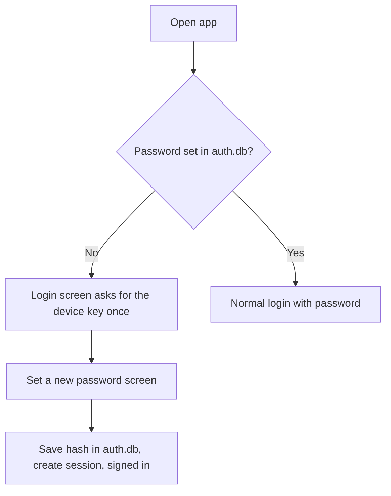
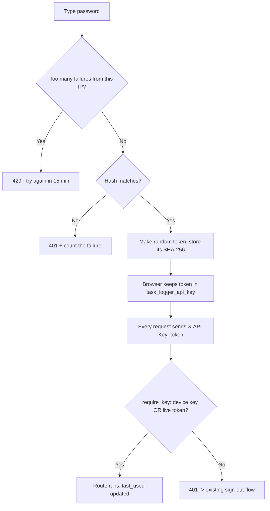
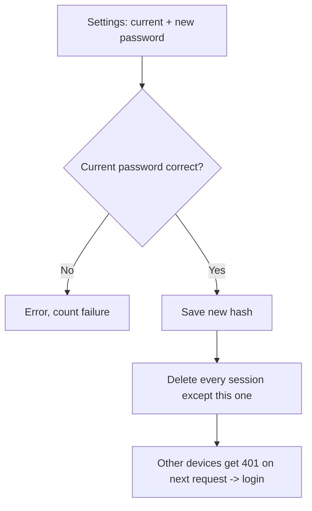
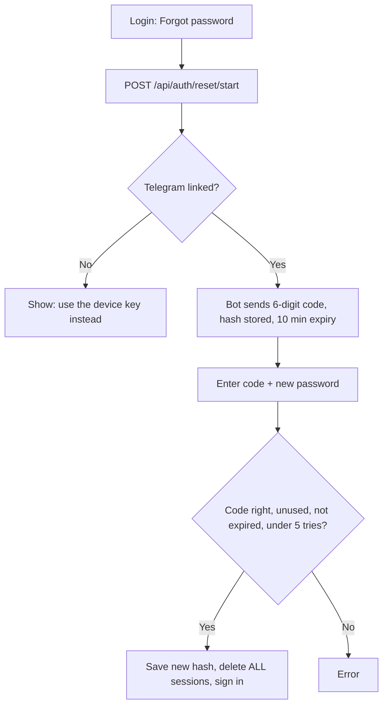
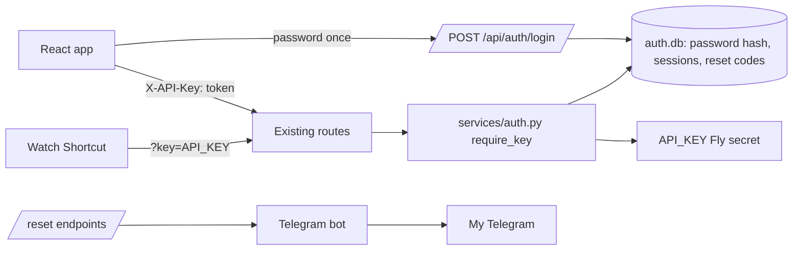

# In-app password change & reset

**Status:** 1. Think  <!-- 1. Think → 2. Draw → 🔒 Locked → 3. Build → ✅ Shipped -->

> Draft plan written 2026-10-07. Step 2 is drafted below so the whole idea
> can be reviewed in one place, but it isn't 🔒 Locked until the open
> questions are answered.

---

## 1. Think

**Problem:** The only way to change the web app's password is
`fly secrets set API_KEY=...` from my Mac. I can't change it from my
phone, and if I think it leaked I can't react quickly.

There's a hidden second problem: **the web "password" and the Apple Watch
key are the same secret** (`API_KEY`). Changing it today also breaks the
Watch Shortcut until I edit the Shortcut by hand. So the real fix is to
**split them**:

| Secret | Used by | Where it lives | Changed how |
|---|---|---|---|
| **Password** (new) | Me, logging in to the web app | `auth.db` on the Fly volume, stored only as a hash | In the app (Settings) |
| **Device key** (`API_KEY`, today's secret) | Watch Shortcut, recovery | Fly secret, as today | `fly secrets set`, rarely |

**Building:**
- A password stored as a **hash** (never the password itself) in a new
  `auth.db`.
- Login swaps the password for a random **session token**; the browser
  keeps the token, not the password.
- **Change password** in Settings (needs the current password). Changing
  it signs out every other device.
- **Forgot password** on the login screen (see open question 1).
- **Sign out everywhere** button (almost free once sessions exist).
- Limit on failed attempts for login and reset.

**Not building:**
- Changing Fly secrets from inside the app (see options - rejected).
- Multi-user accounts, emails, usernames. Still just me.
- Rotating the Watch key from the app (open question 3).
- 2FA / passkeys. Maybe later.

**Options I looked at:**
| Option | Good | Bad |
|--------|------|-----|
| **A. App calls the Fly API to run "secrets set" for me** | Keeps everything as today | The app would hold a Fly API token that can control my whole Fly account - if the app is ever broken into, so is the account. Setting a secret also restarts the machine. And the Watch still breaks. **Rejected.** |
| **B. Store the password hash in SQLite, keep sending the password on every request** | Smallest change | Hashing on purpose is slow (~50-100 ms) - doing it on *every* request slows the app. And the raw password sits in localStorage. |
| **C. Password hash in SQLite + session tokens** ✅ | Password checked only at login. Browser holds a random token that can be revoked. Watch key untouched. | A bit more code: a sessions table and a login endpoint. |

**Why hashes and tokens are safe to store (the "why"):**
- A password hash (`werkzeug.security.generate_password_hash`, scrypt)
  is one-way and deliberately slow, so a stolen `auth.db` can't be
  turned back into the password quickly. werkzeug already comes with
  Flask - **no new dependency**.
- A session token is 32 random bytes, so it can't be guessed. We store
  only its SHA-256 (fast is fine here, because the token is random, not
  something a person chose). A leaked `auth.db` then contains no usable
  tokens.

**Open questions:**
- [ ] 1. **How do I reset a forgotten password?**
      (a) *Telegram code* - the bot sends a 6-digit code to my linked chat,
      valid 10 min, one use, 5 tries. Fully in-app, reuses the existing
      link. (b) *Device key* - type `API_KEY` (it's in the Watch
      Shortcut on my iPhone) + a new password. **Suggestion: both** -
      Telegram as the normal path, device key as the break-glass path if
      Telegram is ever unlinked.
- [ ] 2. **Should the device key still unlock the whole web app?**
      Today it does. Keeping that makes the switch-over painless, but means
      a leaked Watch key still opens everything. Suggestion: keep it for
      now; tighten it to Watch routes (`/toggle`, `/status`) only in the
      security review.
- [ ] 3. **Rotate the Watch key from the app too?** Would need the device
      key moved into `auth.db` as well. Suggestion: not now - rarely
      needed, and the Shortcut has to be edited by hand anyway.
- [ ] 4. **Minimum password length** - suggestion: 12 characters, no other
      rules.

---

## 2. Draw *(draft)*

### Flowchart 1 - first login after this ships (one time)

### Flowchart 2 - login and normal use

### Flowchart 3 - change password (Settings)

### Flowchart 4 - forgot password (if Telegram reset is chosen)

### Architecture

### New/changed pieces
- `services/auth_db.py` - `auth.db` with tables `password` (one row:
  hash, changed_at), `sessions` (token_sha256, created_at, last_used_at),
  `reset_codes` (code_hash, created_at, used_at, attempts).
- `services/auth.py` - `require_key` also accepts a live session token;
  compare with `hmac.compare_digest` (fixes today's plain `!=`).
- `routes/auth.py` - `POST /api/auth/login`, `POST /api/auth/logout`,
  `POST /api/auth/logout-all`, `POST /api/auth/password`,
  `POST /api/auth/reset/start`, `POST /api/auth/reset/finish`.
- Frontend: `api/auth.ts`; LoginScreen gets a password field, "Set a
  password" step and "Forgot password"; Settings gets "Change password"
  and "Sign out everywhere".
- Tests: login, wrong password, lockout, change password kills other
  sessions, reset code expiry/one-use, and **`test_watch_contract.py`
  must still pass unchanged**.

### Decisions
- Option C (hash + tokens), because the password is checked once and the
  browser never stores it. *(draft)*
- Device key stays a Fly secret and keeps working for the Watch, so the
  frozen `/toggle` + `/status` contract doesn't change. *(draft)*
- Token goes in the existing `task_logger_api_key` localStorage key and
  the `X-API-Key` header, so the frozen key names and `api/client.ts`
  barely change. Server also expires sessions after 24h idle, matching
  the frontend's sliding expiry. *(draft)*
- Failed-attempt counter kept in memory (5 fails → 15 min wait). Fine
  because there's always exactly one machine; it resets on restart,
  which is acceptable. *(draft)*
- Never log passwords, tokens or codes. *(draft)*

---

## 3. Build

*(Not started - waiting for 🔒 Locked.)*

**What actually got built / what I learned:**
