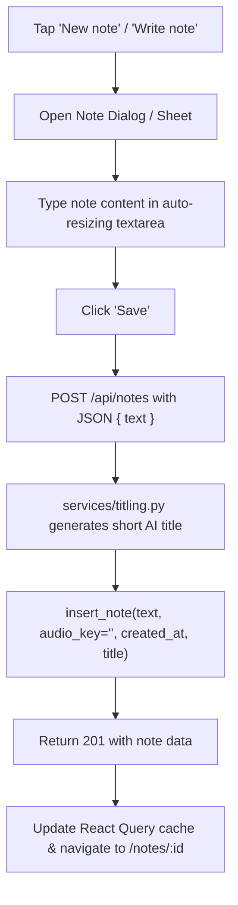
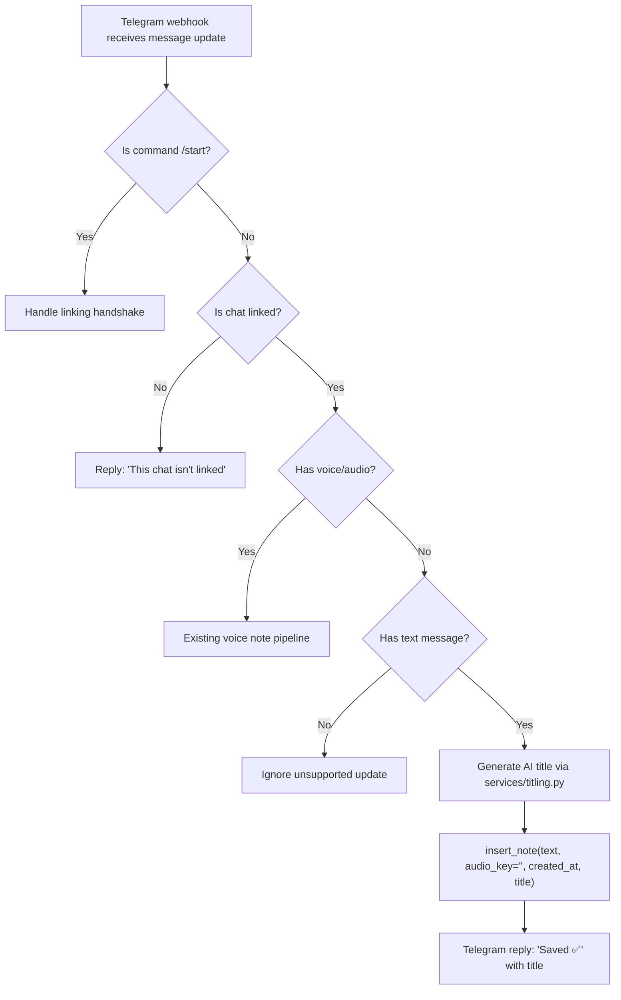
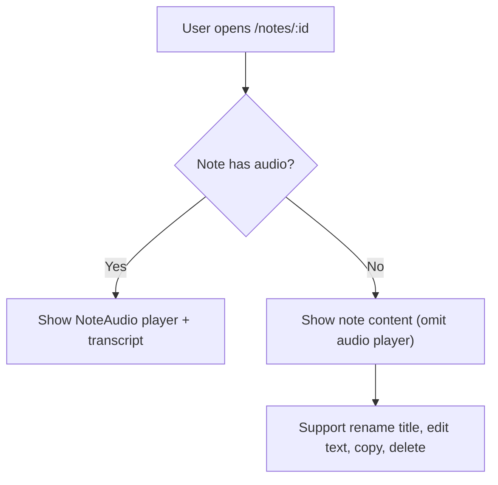
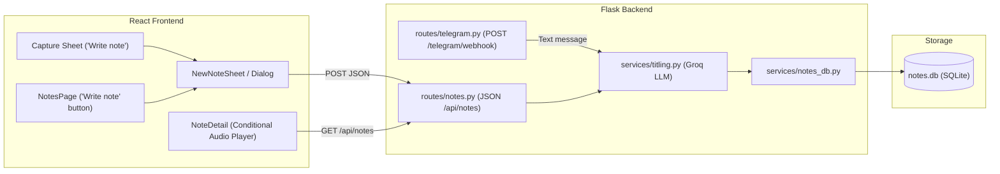

# Text Notes & Telegram Text Capture

**Status:** ✅ Shipped  <!-- 1. Think → 2. Draw → 🔒 Locked → 3. Build → ✅ Shipped -->

---

## 1. Think

**Problem:**
Currently, Notes only supports voice recording (in the web app and via Telegram). If Vivek is in a quiet space, in a meeting, or prefers typing a quick thought, checklist, or snippet, he cannot create a note. Furthermore, sending a regular text chat to the Telegram bot gets rejected with "Send me a voice note" instead of being saved as a note.

**Building:**
- A text note creation interface in the web app (accessible from the Notes page and the Capture sheet).
- Saving text notes directly to `notes.db` without requiring an audio recording or Tigris storage.
- Groq AI titling for text notes (consistent with voice notes, falling back gracefully if rate-limited or offline).
- Displaying and editing text notes cleanly in the UI (hiding the audio player when no audio exists).
- Telegram text message ingestion: Any regular text message sent to the linked Telegram bot is automatically saved as a note, titled with AI, and acknowledged with `Saved ✅`.

**Not building:**
- Rich media attachments (images, PDFs, file uploads) - keeping notes text and voice only.
- Complex hierarchical folders, nested tags, or Notion-style multi-block databases (out of scope for Sheev).
- Real-time collaborative editing (Sheev is single-user).
- Two-way chat bot conversations (the Telegram bot is an ingest channel, not a chatbot).

**Options I looked at for the Note-Taking Interface:**

| Option | Good | Bad |
|--------|------|-----|
| **1. Native Markdown/Textarea + Auto-resize (Zero new dependencies)** | 0 KB added to bundle, 100% React 19 compatible, fast mobile typing, matches Sheev's minimalist design philosophy, no peer-dep risks. | Formatting is written in markdown syntax rather than WYSIWYG button clicks (bold, lists, headings). |
| **2. TipTap (`@tiptap/react` + `@tiptap/starter-kit`)** | WYSIWYG rich text, bubble toolbar for bold/headings/lists, markdown shortcuts (`# `, `* `). | Adds ~40-60 KB bundle size (budget is 250 KB), extra schema complexity, requires testing React 19 peer dependencies. |
| **3. `@uiw/react-md-editor` or `md-editor-rt`** | Markdown editor with toolbar and preview tab out of the box. | Heavier bundle, styling can clash with custom design tokens, risk of React 19 compatibility issues. |

**Open questions:**
- [x] Which editor experience do we prefer: a lightweight native Markdown textarea (0 new deps, fast, clean) or a WYSIWYG rich-text library like TipTap?
  *Decision:* Option 1 — Native auto-expanding Markdown textarea with zero new dependencies. Aligns with Sheev's philosophy and strict bundle budget.
- [x] Should in-app text notes have a separate manual Title field, or should the title be auto-generated by Groq AI from the note text (with the ability to rename, matching voice notes)?
  *Decision:* Yes, auto-title text notes using Groq AI (`openai/gpt-oss-20b`), matching voice notes. Vivek can edit/rename the title anytime.
- [x] For Telegram text notes, should any text message be ingested as a note, or should there be a command / threshold (e.g. ignore 1-word messages or treat everything as a note)?
  *Decision:* All normal non-empty text messages (excluding `/start` command) from linked chats are captured as notes.
- [x] In `notes.db`, how should we handle the existing `audio_key TEXT NOT NULL` column for text notes (allow empty string `""` or alter schema to make it nullable)?
  *Decision:* Store `audio_key = ""` (empty string) for text notes. This satisfies the existing `NOT NULL` constraint on existing SQLite volumes with zero migration risk or breakage.

---

## 2. Draw

### Flowchart 1 — In-App Text Note Creation

### Flowchart 2 — Telegram Text Message Ingestion

### Flowchart 3 — Reading & Note Detail

### Architecture — Components and Data Flow

### Decisions
- **Option 1 (Native Markdown Textarea) chosen:** 0 KB bundle increase, 0 risk of React 19 incompatibility, matches Sheev tokens and dark mode.
- **Unified `POST /api/notes`:** Accepts either `multipart/form-data` (audio file) or `application/json` (`{"text": "..."}`). Unified endpoint keeps the REST API clean and intuitive.
- **Groq AI titling for text notes:** Shares the same titling helper as voice notes (`services/titling.py`). Titling never blocks saving; falls back to `title = None` on failure.
- **`audio_key = ""` representation:** Stores empty string `""` in `notes.db` so existing tables with `audio_key TEXT NOT NULL` don't require risky migrations or table rebuilds.
- **`has_audio` flag in Note payload:** API returns `has_audio: bool` and `audio_url: string | null`. When `has_audio` is false, frontend hides audio player cleanly and does not report audio errors.
- **Telegram ingest:** Plain text messages from linked users are automatically ingested into `notes.db`, titled with AI, and acknowledged with `Saved ✅\n\n<title>`.

---

## 3. Build

- [x] **Backend `services/notes_db.py`**: Support notes without audio (allow empty `audio_key=""`).
- [x] **Backend `routes/notes.py`**: Support `POST /api/notes` with JSON payload `{"text": "..."}`, invoke `titling.py`, save note, and return `{ ok: true, note: { ..., has_audio: false } }`.
- [x] **Backend `routes/telegram.py`**: Ingest plain text messages, generate title, save note to `notes.db`, and reply with `Saved ✅`.
- [x] **Backend tests**: Add pytest tests covering `POST /api/notes` with JSON text, titling fallback, and Telegram text ingestion.
- [x] **Frontend types & API (`frontend/src/`)**: Update `Note` type with `has_audio?: boolean`, add `createTextNote(text: string)` to `frontend/src/api/notes.ts`.
- [x] **Frontend UI**:
  - Create `NewNoteDialog` / `NewNoteSheet` with auto-resizing textarea and save button.
  - Add "Write note" button to `NotesPage` header and `CaptureSheet`.
  - Update `NoteDetail` and `useNoteAudio` to omit audio player when `has_audio` is false.
- [x] **Frontend tests & verification**: Run vitest, lint, and build checks.
- [x] **Docs sync**: Update `PROJECT_STRUCTURE.md`, `TODO.md`, and `docs/claude-handoff.md`.

**What actually got built / what I learned:**
- Built full support for in-app text note creation with a responsive modal sheet (`NewNoteSheet`) and keyboard shortcut support (⌘+Enter / Ctrl+Enter).
- Reused the shared Groq AI titling service (`services/titling.py`) for text notes so both voice and typed notes get concise titles automatically without extra configuration.
- Extended the Telegram webhook (`routes/telegram.py`) so regular text messages sent to the bot are saved into `notes.db`, titled with AI, and replied to with `Saved ✅ <title>\n\n<text>`.
- Using an empty string `audio_key=""` and `has_audio: bool` avoided any destructive SQLite database migrations, guaranteeing seamless backward compatibility with existing databases on Fly.
- Clean and simple plain-text notes experience without extra formatting toolbars or markdown syntax parsers.
- Kept the JS bundle addition minimal (~2 KB gzipped), remaining well within the 250 KB budget (179.8 KB gzipped).

